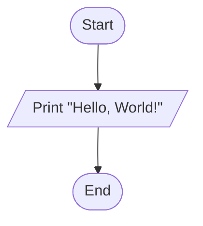
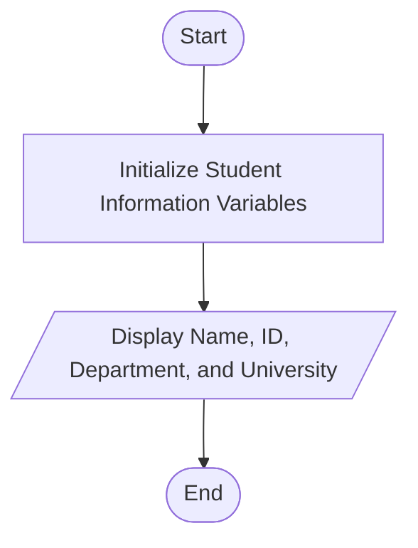

# Lab 01: Basic C Programming

## Question 1

Write a C program to print "Hello, World!".

**Flowchart**



**Program** ([`solution.c`](Q01_hello_world/solution.c))

```c
#include <stdio.h>
int main()
{
    printf("Hello, World!");

    return 0;
}
```

**Input**

No input required.

**Output**

```text
Hello, World!
```

---

## Question 2

Write a C program to display your name, ID, department, and university name.

**Flowchart**



**Program** ([`solution.c`](Q02_student_info/solution.c))

```c
#include <stdio.h>
int main()
{
    printf("Name       : Ashik Ridwan\n");
    printf("ID         : 1025\n");
    printf("Department : Computer Science and Engineering (CSE)\n");
    printf("University : First Capital University Bangladesh\n");

    return 0;
}
```

**Input**

No input required.

**Output**

```text
Name       : Ashik Ridwan
ID         : 1025
Department : Computer Science and Engineering (CSE)
University : First Capital University Bangladesh
```