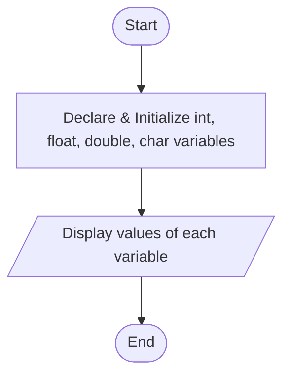
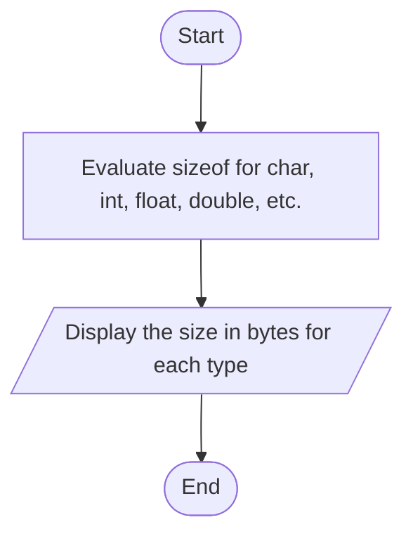

# Lab 02: Variables, Constants and Data Types

## Question 4

Write a C program to declare and display variables of different data types.

**Flowchart**



**Program** ([`solution.c`](Q04_data_types/solution.c))

```c
#include <stdio.h>
int main()
{
    int age = 20;
    float height = 5.8f;
    double pi = 3.141592653;
    char grade = 'A';
    long population = 170000000;

    printf("int    age        = %d\n", age);
    printf("float  height     = %.1f\n", height);
    printf("double pi         = %.9lf\n", pi);
    printf("char   grade      = %c\n", grade);
    printf("long   population = %ld\n", population);

    return 0;
}
```

**Input**

No input required.

**Output**

```text
int    age        = 20
float  height     = 5.8
double pi         = 3.141592653
char   grade      = A
long   population = 170000000
```

---

## Question 5

Write a C program to display the size of different data types using sizeof().

**Flowchart**



**Program** ([`solution.c`](Q05_sizeof_data_types/solution.c))

```c
#include <stdio.h>
int main()
{
    printf("Size of char        = %d byte(s)\n", (int)sizeof(char));
    printf("Size of short       = %d byte(s)\n", (int)sizeof(short));
    printf("Size of int         = %d byte(s)\n", (int)sizeof(int));
    printf("Size of long        = %d byte(s)\n", (int)sizeof(long));
    printf("Size of long long   = %d byte(s)\n", (int)sizeof(long long));
    printf("Size of float       = %d byte(s)\n", (int)sizeof(float));
    printf("Size of double      = %d byte(s)\n", (int)sizeof(double));
    printf("Size of long double = %d byte(s)\n", (int)sizeof(long double));

    return 0;
}
```

**Input**

No input required.

**Output**

```text
Size of char        = 1 byte(s)
Size of short       = 2 byte(s)
Size of int         = 4 byte(s)
Size of long        = 8 byte(s)
Size of long long   = 8 byte(s)
Size of float       = 4 byte(s)
Size of double      = 8 byte(s)
Size of long double = 16 byte(s)
```
