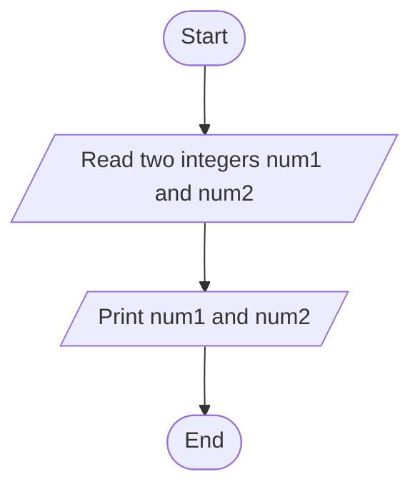
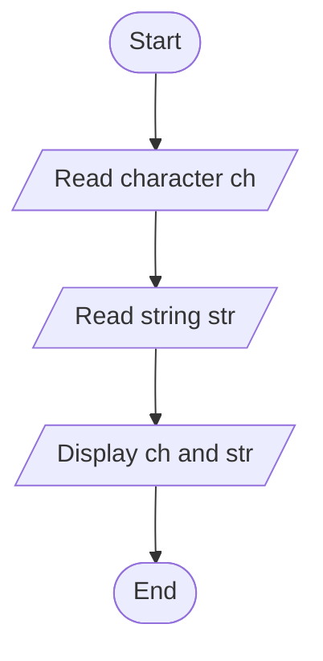

# Lab 03: Input and Output

## Question 7

Write a C program to take two integers as input and display them.

**Flowchart**



**Program** ([`solution.c`](Q07_input_two_integers/solution.c))

```c
#include <stdio.h>
int main()
{
    int a, b;

    printf("Enter two integers: ");
    scanf("%d %d", &a, &b);

    printf("First number  = %d\n", a);
    printf("Second number = %d\n", b);

    return 0;
}
```

**Input**

```text
15 27
```

**Output**

```text
Enter two integers: 15 27
First number  = 15
Second number = 27
```

---

## Question 8

Write a C program to take a character and a string as input and display them.

**Flowchart**



**Program** ([`solution.c`](Q08_char_and_string/solution.c))

```c
#include <stdio.h>
int main()
{
    char ch;
    char str[50];

    printf("Enter a character: ");
    scanf(" %c", &ch);

    printf("Enter a string (one word): ");
    scanf("%49s", str);

    printf("Character = %c\n", ch);
    printf("String    = %s\n", str);

    return 0;
}
```

**Input**

```text
A
Bangladesh
```

**Output**

```text
Enter a character: A
Enter a string (one word): Bangladesh
Character = A
String    = Bangladesh
```

---
