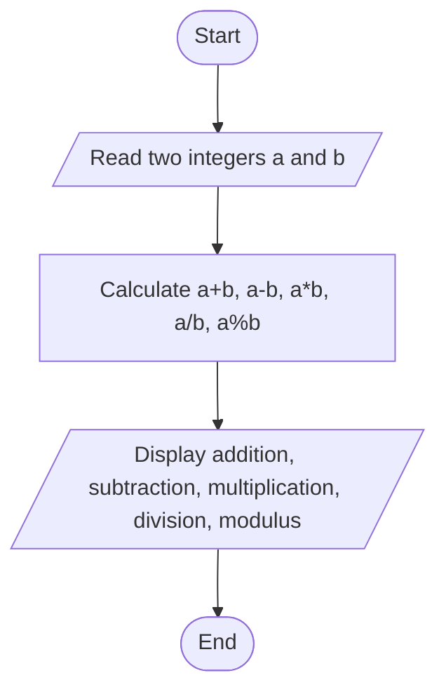
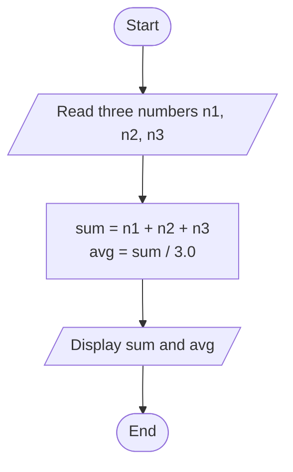

# Lab 04: Arithmetic Operators

## Question 10

Write a C program to perform addition, subtraction, multiplication, division, and modulus of two numbers.

**Flowchart**



**Program** ([`solution.c`](Q10_arithmetic_operations/solution.c))

```c
#include <stdio.h>
int main()
{
    int a, b, sum, diff, prod, mod;
    float quotient;

    printf("Enter two integers (second one must not be 0): ");
    scanf("%d %d", &a, &b);

    sum = a + b;
    diff = a - b;
    prod = a * b;
    quotient = (float)a / b;
    mod = a % b;

    printf("Addition       : %d + %d = %d\n", a, b, sum);
    printf("Subtraction    : %d - %d = %d\n", a, b, diff);
    printf("Multiplication : %d * %d = %d\n", a, b, prod);
    printf("Division       : %d / %d = %.2f\n", a, b, quotient);
    printf("Modulus        : %d %% %d = %d\n", a, b, mod);

    return 0;
}
```

**Input**

```text
17 5
```

**Output**

```text
Enter two integers (second one must not be 0): 17 5
Addition       : 17 + 5 = 22
Subtraction    : 17 - 5 = 12
Multiplication : 17 * 5 = 85
Division       : 17 / 5 = 3.40
Modulus        : 17 % 5 = 2
```

---

## Question 11

Write a C program to calculate the sum and average of three numbers.

**Flowchart**



**Program** ([`solution.c`](Q11_sum_and_average/solution.c))

```c
#include <stdio.h>
int main()
{
    int a, b, c, sum;
    float average;

    printf("Enter three integers: ");
    scanf("%d %d %d", &a, &b, &c);

    sum = a + b + c;
    average = sum / 3.0;

    printf("Sum     = %d\n", sum);
    printf("Average = %.2f\n", average);

    return 0;
}
```

**Input**

```text
10 20 35
```

**Output**

```text
Enter three integers: 10 20 35
Sum     = 65
Average = 21.67
```

---
