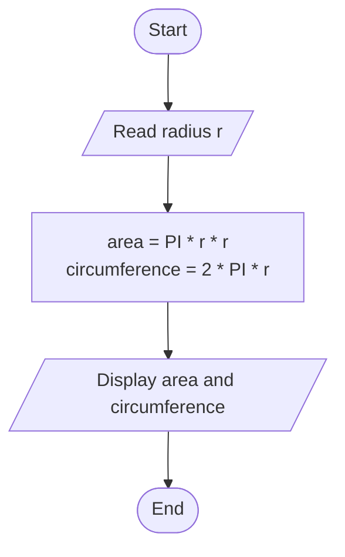
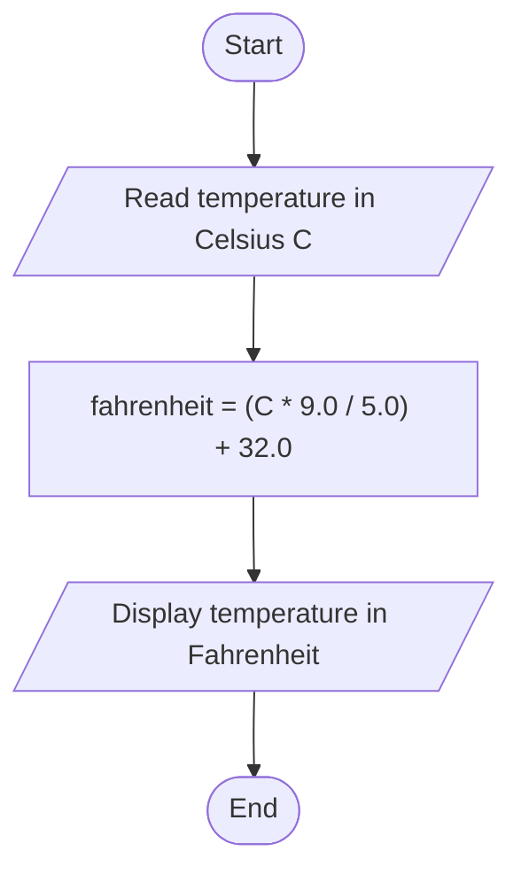

# Lab 05: More Arithmetic Problems

## Question 13

Write a C program to calculate the area and circumference of a circle.

**Flowchart**



**Program** ([`solution.c`](Q13_circle_area_circumference/solution.c))

```c
#include <stdio.h>
#define PI 3.14159

int main()
{
    float radius, area, circumference;

    printf("Enter the radius of the circle: ");
    scanf("%f", &radius);

    area = PI * radius * radius;
    circumference = 2 * PI * radius;

    printf("Area          = %.2f\n", area);
    printf("Circumference = %.2f\n", circumference);

    return 0;
}
```

**Input**

```text
5
```

**Output**

```text
Enter the radius of the circle: 5
Area          = 78.54
Circumference = 31.42
```

---

## Question 14

Write a C program to convert Celsius to Fahrenheit.

**Flowchart**



**Program** ([`solution.c`](Q14_celsius_to_fahrenheit/solution.c))

```c
#include <stdio.h>
int main()
{
    float celsius, fahrenheit;

    printf("Enter temperature in Celsius: ");
    scanf("%f", &celsius);

    fahrenheit = (celsius * 9 / 5) + 32;

    printf("%.2f C = %.2f F\n", celsius, fahrenheit);

    return 0;
}
```

**Input**

```text
37
```

**Output**

```text
Enter temperature in Celsius: 37
37.00 C = 98.60 F
```

---
