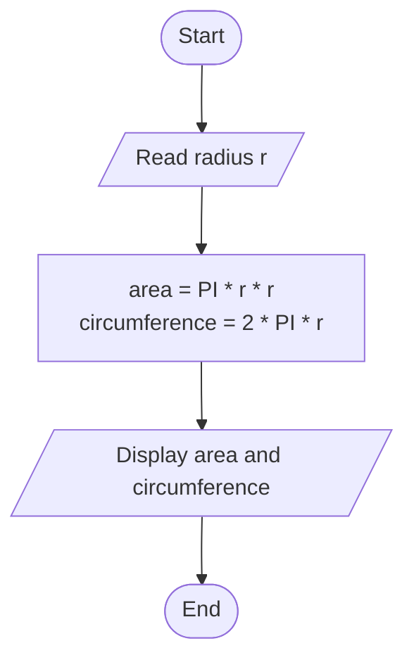
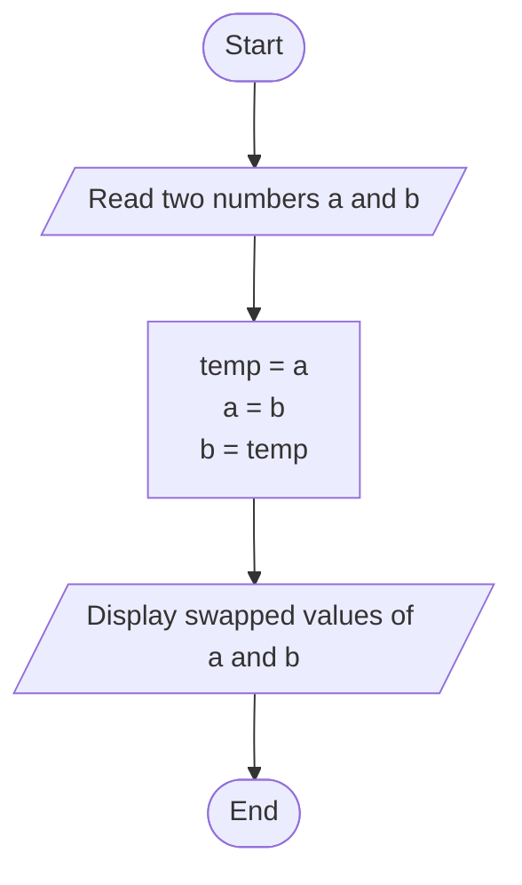

# Lab 06: Increment, Decrement and Assignment Operators

## Question 17

Write a C program to demonstrate the use of increment and decrement operators.

**Flowchart**



**Program** ([`solution.c`](Q17_increment_decrement/solution.c))

```c
#include <stdio.h>
int main()
{
    int a = 10;

    printf("Initial value of a     = %d\n", a);

    printf("Post-increment (a++)   = %d\n", a++);   // 10, then a = 11
    printf("Value of a now         = %d\n", a);

    printf("Pre-increment  (++a)   = %d\n", ++a);   // a = 12, then 12
    printf("Post-decrement (a--)   = %d\n", a--);   // 12, then a = 11
    printf("Value of a now         = %d\n", a);

    printf("Pre-decrement  (--a)   = %d\n", --a);   // a = 10, then 10

    return 0;
}
```

**Input**

No input required.

**Output**

```text
Initial value of a     = 10
Post-increment (a++)   = 10
Value of a now         = 11
Pre-increment  (++a)   = 12
Post-decrement (a--)   = 12
Value of a now         = 11
Pre-decrement  (--a)   = 10
```

---

## Question 18

Write a C program to swap two numbers using a third variable.

**Flowchart**



**Program** ([`solution.c`](Q18_swap_numbers/solution.c))

```c
#include <stdio.h>
int main()
{
    int a, b, temp;

    printf("Enter two numbers: ");
    scanf("%d %d", &a, &b);

    printf("Before swapping: a = %d, b = %d\n", a, b);

    temp = a;
    a = b;
    b = temp;

    printf("After swapping : a = %d, b = %d\n", a, b);

    return 0;
}
```

**Input**

```text
10 20
```

**Output**

```text
Enter two numbers: 10 20
Before swapping: a = 10, b = 20
After swapping : a = 20, b = 10
```

---
