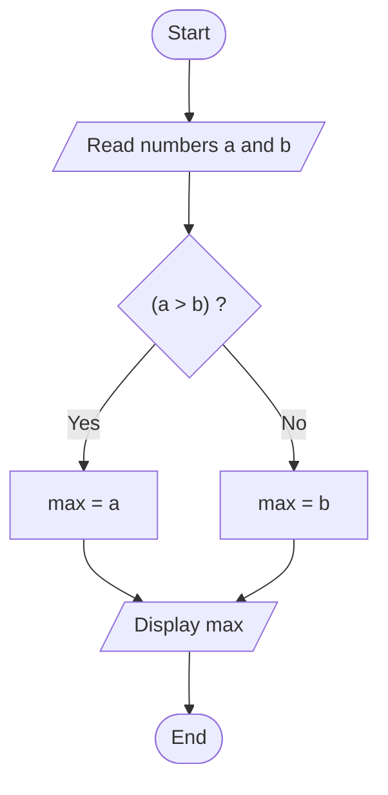
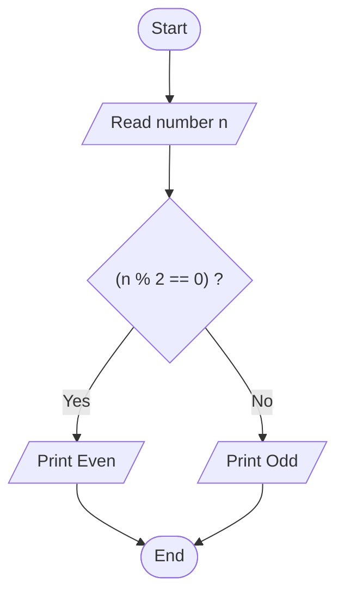

# Lab 07: Conditional Operator

## Question 20

Write a C program to find the larger of two numbers using the conditional operator.

**Flowchart**



**Program** ([`solution.c`](Q20_larger_of_two/solution.c))

```c
#include <stdio.h>
int main()
{
    int a, b, larger;

    printf("Enter two numbers: ");
    scanf("%d %d", &a, &b);

    larger = (a > b) ? a : b;

    printf("The larger number is %d\n", larger);

    return 0;
}
```

**Input**

```text
25 40
```

**Output**

```text
Enter two numbers: 25 40
The larger number is 40
```

---

## Question 21

Write a C program to check whether a number is even or odd using the conditional operator.

**Flowchart**



**Program** ([`solution.c`](Q21_even_odd_conditional/solution.c))

```c
#include <stdio.h>
int main()
{
    int n;

    printf("Enter a number: ");
    scanf("%d", &n);

    printf("%d is %s.\n", n, (n % 2 == 0) ? "Even" : "Odd");

    return 0;
}
```

**Input**

```text
14
```

**Output**

```text
Enter a number: 14
14 is Even.
```

---
