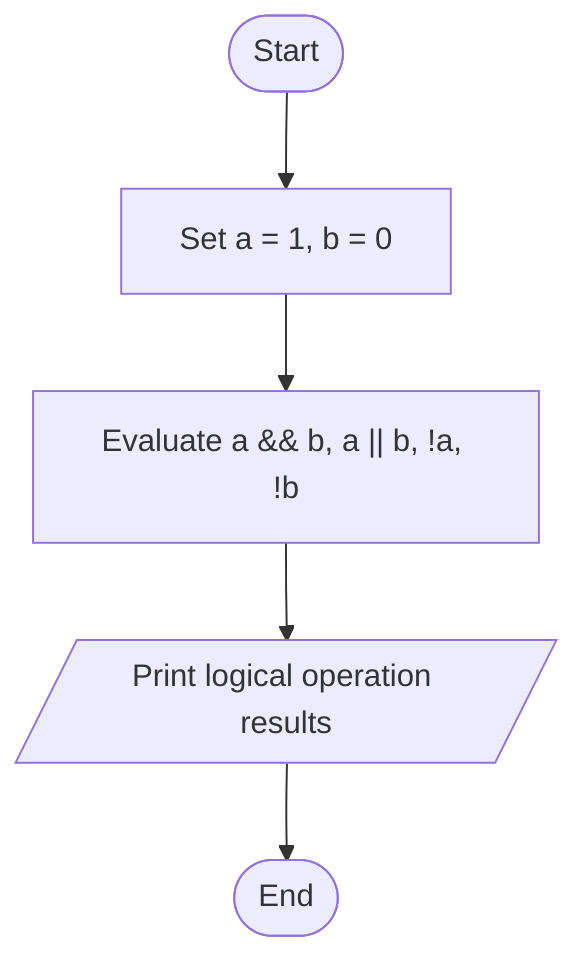
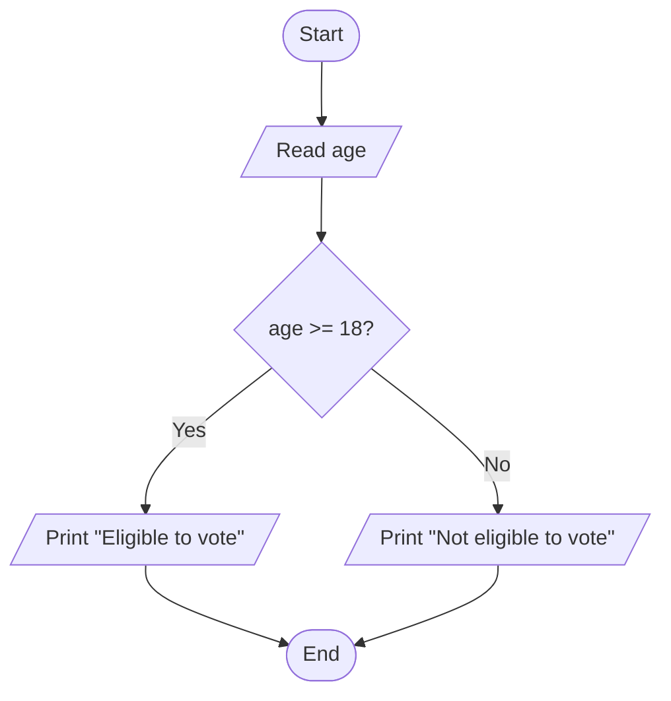

# Lab 08: Relational and Logical Operators

## Question 23

Write a C program to demonstrate the use of logical AND, OR, and NOT operators.

**Flowchart**



**Program** ([`solution.c`](Q23_logical_operators/solution.c))

```c
#include <stdio.h>
int main()
{
    int a = 10, b = 20, c = 30;

    printf("a = %d, b = %d, c = %d\n\n", a, b, c);

    printf("Logical AND (&&)\n");
    printf("(a < b) && (b < c) = %d\n", (a < b) && (b < c));
    printf("(a > b) && (b < c) = %d\n\n", (a > b) && (b < c));

    printf("Logical OR (||)\n");
    printf("(a > b) || (b < c) = %d\n", (a > b) || (b < c));
    printf("(a > b) || (b > c) = %d\n\n", (a > b) || (b > c));

    printf("Logical NOT (!)\n");
    printf("!(a < b) = %d\n", !(a < b));
    printf("!(a > b) = %d\n\n", !(a > b));

    printf("(1 = True, 0 = False)\n");

    return 0;
}
```

**Input**

No input required.

**Output**

```text
a = 10, b = 20, c = 30

Logical AND (&&)
(a < b) && (b < c) = 1
(a > b) && (b < c) = 0

Logical OR (||)
(a > b) || (b < c) = 1
(a > b) || (b > c) = 0

Logical NOT (!)
!(a < b) = 0
!(a > b) = 1

(1 = True, 0 = False)
```

---

## Question 24

Write a C program to check whether a person is eligible to vote.

**Flowchart**



**Program** ([`solution.c`](Q24_voting_eligibility/solution.c))

```c
#include <stdio.h>
int main()
{
    int age;

    printf("Enter your age: ");
    scanf("%d", &age);

    if (age >= 18)
        printf("You are eligible to vote.\n");
    else
        printf("You are not eligible to vote.\n");

    return 0;
}
```

**Input**

```text
20
```

**Output**

```text
Enter your age: 20
You are eligible to vote.
```

---
