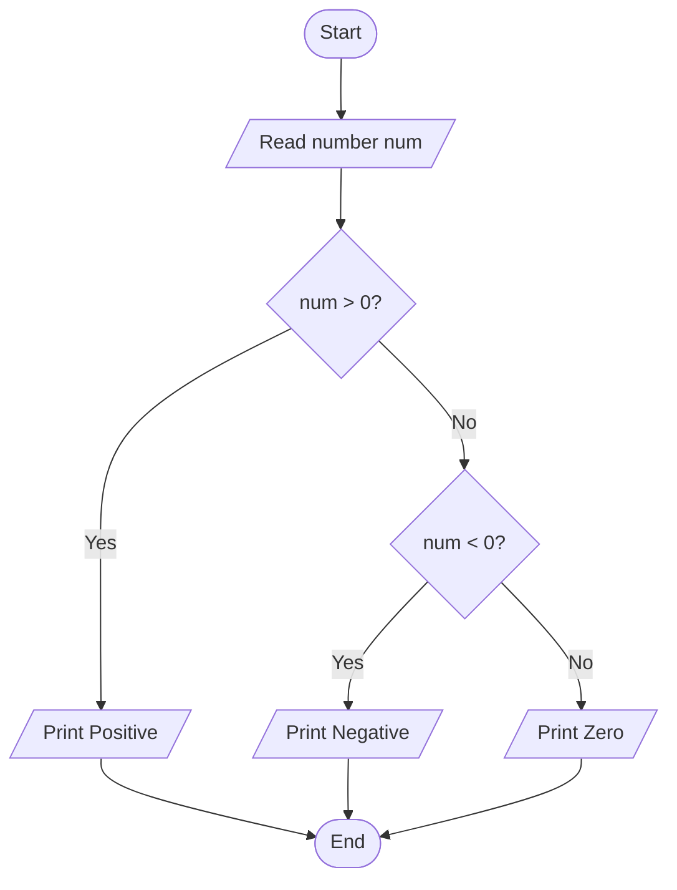
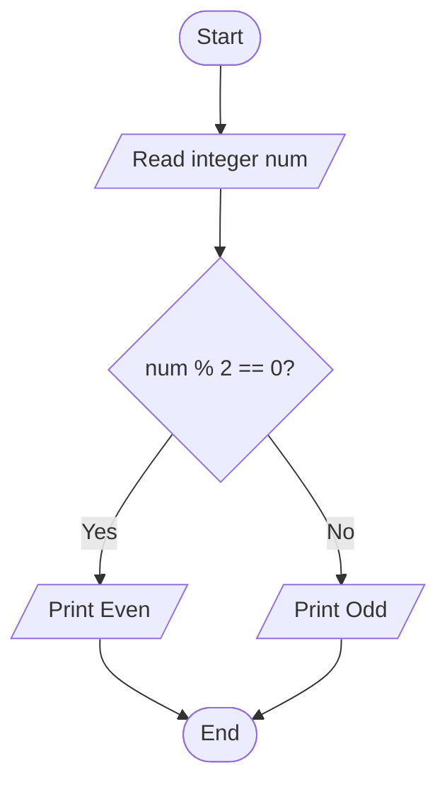

# Lab 09: if Statement

## Question 26

Write a C program to check whether a number is positive, negative, or zero.

**Flowchart**



**Program** ([`solution.c`](Q26_positive_negative_zero/solution.c))

```c
#include <stdio.h>
int main()
{
    int n;

    printf("Enter a number: ");
    scanf("%d", &n);

    if (n > 0)
        printf("%d is positive.\n", n);

    if (n < 0)
        printf("%d is negative.\n", n);

    if (n == 0)
        printf("The number is zero.\n");

    return 0;
}
```

**Input**

```text
15
```

**Output**

```text
Enter a number: 15
15 is positive.
```

---

## Question 27

Write a C program to check whether a number is even or odd.

**Flowchart**




**Program** ([`solution.c`](Q27_even_odd_if/solution.c))

```c
#include <stdio.h>
int main()
{
    int n;

    printf("Enter a number: ");
    scanf("%d", &n);

    if (n % 2 == 0)
        printf("%d is even.\n", n);

    if (n % 2 != 0)
        printf("%d is odd.\n", n);

    return 0;
}
```

**Input**

```text
7
```

**Output**

```text
Enter a number: 7
7 is odd.
```

---
