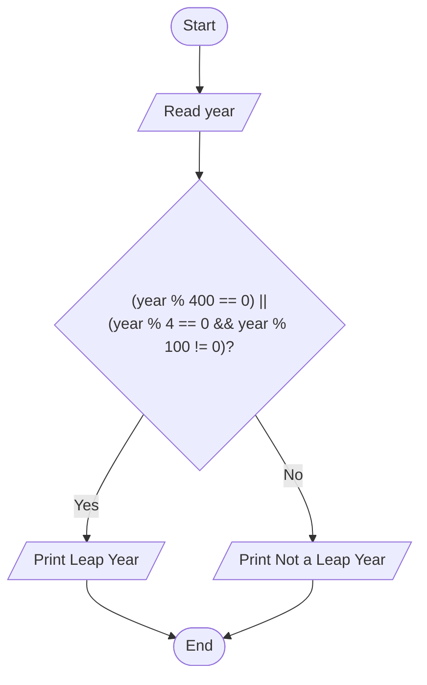
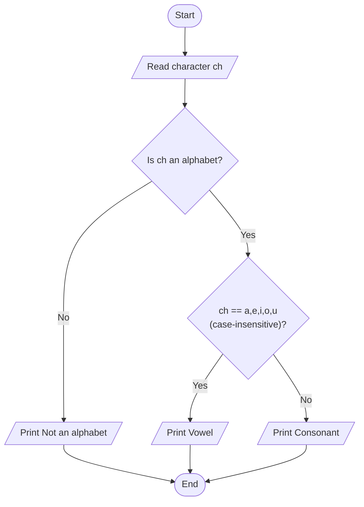

# Lab 10: if-else Statement

## Question 29

Write a C program to check whether a year is a leap year or not.

**Flowchart**



**Program** ([`solution.c`](Q29_leap_year/solution.c))

```c
#include <stdio.h>
int main()
{
    int year;

    printf("Enter a year: ");
    scanf("%d", &year);

    if ((year % 4 == 0 && year % 100 != 0) || (year % 400 == 0))
        printf("%d is a leap year.\n", year);
    else
        printf("%d is not a leap year.\n", year);

    return 0;
}
```

**Input**

```text
2024
```

**Output**

```text
Enter a year: 2024
2024 is a leap year.
```

---

## Question 30

Write a C program to check whether a character is a vowel or consonant.

**Flowchart**



**Program** ([`solution.c`](Q30_vowel_consonant/solution.c))

```c
#include <stdio.h>
int main()
{
    char ch;

    printf("Enter a character: ");
    scanf(" %c", &ch);

    if ((ch >= 'a' && ch <= 'z') || (ch >= 'A' && ch <= 'Z'))
    {
        if (ch == 'a' || ch == 'e' || ch == 'i' || ch == 'o' || ch == 'u' ||
            ch == 'A' || ch == 'E' || ch == 'I' || ch == 'O' || ch == 'U')
            printf("%c is a vowel.\n", ch);
        else
            printf("%c is a consonant.\n", ch);
    }
    else
        printf("%c is not an alphabet.\n", ch);

    return 0;
}
```

**Input**

```text
e
```

**Output**

```text
Enter a character: e
e is a vowel.
```

---
