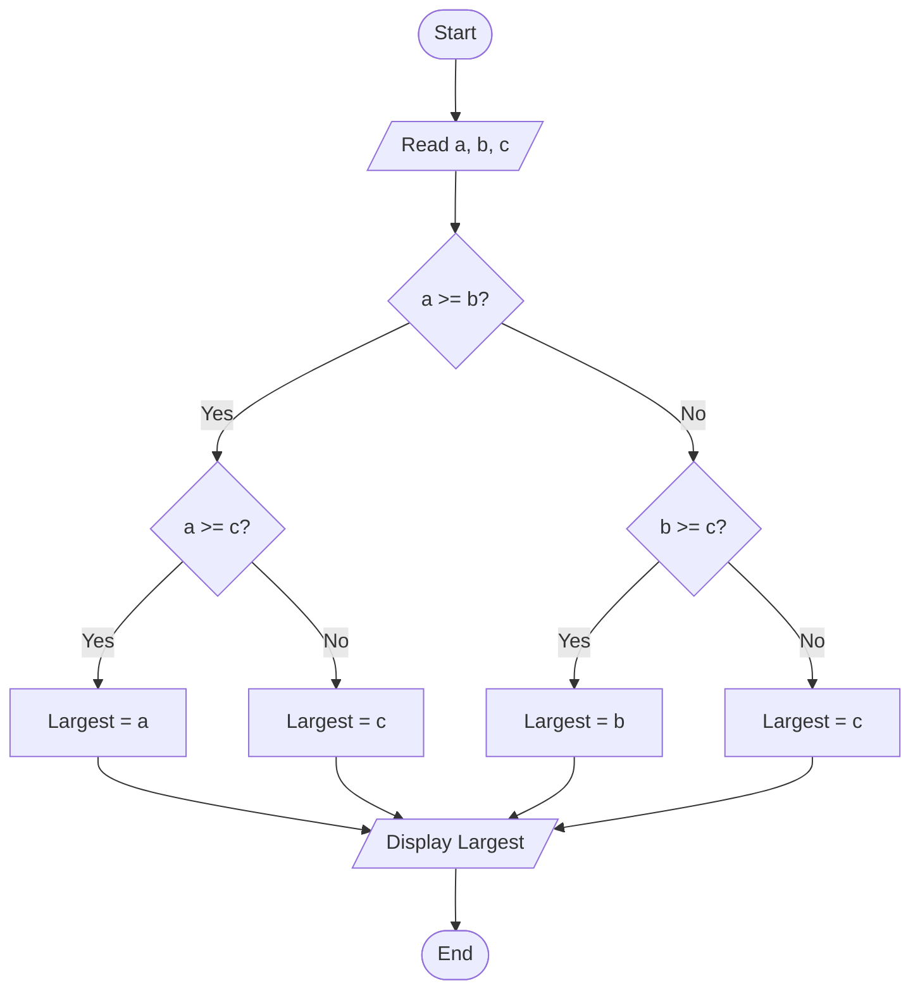
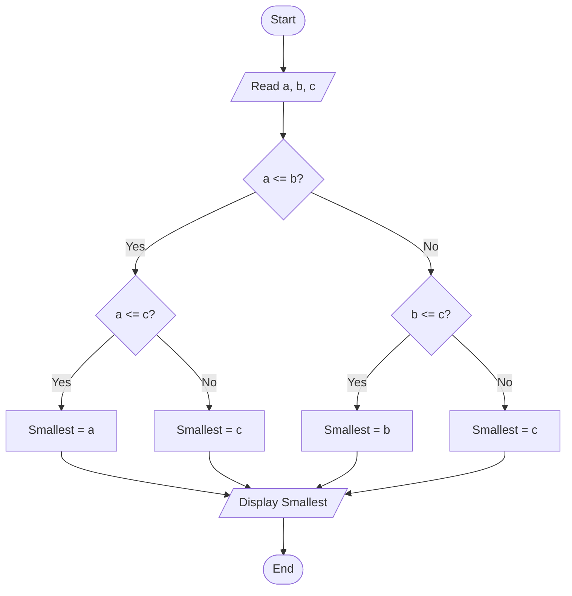

# Lab 11: Nested if

## Question 32

Write a C program to find the largest among three numbers using nested if.

**Flowchart**



**Program** ([`solution.c`](Q32_largest_of_three/solution.c))

```c
#include <stdio.h>
int main()
{
    int a, b, c, largest;

    printf("Enter three numbers: ");
    scanf("%d %d %d", &a, &b, &c);

    if (a >= b)
    {
        if (a >= c)
            largest = a;
        else
            largest = c;
    }
    else
    {
        if (b >= c)
            largest = b;
        else
            largest = c;
    }

    printf("The largest number is %d\n", largest);

    return 0;
}
```

**Input**

```text
12 45 30
```

**Output**

```text
Enter three numbers: 12 45 30
The largest number is 45
```

---

## Question 33

Write a C program to find the smallest among three numbers using nested if.

**Flowchart**



**Program** ([`solution.c`](Q33_smallest_of_three/solution.c))

```c
#include <stdio.h>
int main()
{
    int a, b, c, smallest;

    printf("Enter three numbers: ");
    scanf("%d %d %d", &a, &b, &c);

    if (a <= b)
    {
        if (a <= c)
            smallest = a;
        else
            smallest = c;
    }
    else
    {
        if (b <= c)
            smallest = b;
        else
            smallest = c;
    }

    printf("The smallest number is %d\n", smallest);

    return 0;
}
```

**Input**

```text
25 9 17
```

**Output**

```text
Enter three numbers: 25 9 17
The smallest number is 9
```

---
