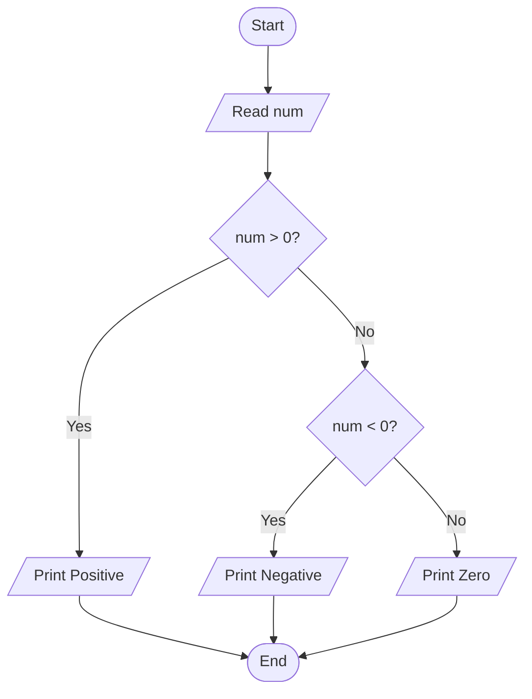

# Lab 12: else-if Ladder

## Question 35

Write a C program to determine whether a number is positive, negative, or zero using an else-if ladder.

**Flowchart**


**Program** ([`solution.c`](Q35_sign_else_if/solution.c))

```c
#include <stdio.h>
int main()
{
    int n;

    printf("Enter a number: ");
    scanf("%d", &n);

    if (n > 0)
        printf("%d is positive.\n", n);
    else if (n < 0)
        printf("%d is negative.\n", n);
    else
        printf("The number is zero.\n");

    return 0;
}
```

**Input**

```text
-7
```

**Output**

```text
Enter a number: -7
-7 is negative.
```

---

## Question 36

Write a C program to display the day of the week based on a number from 1 to 7.

**Flowchart**

```mermaid
flowchart TD
    Start([Start]) --> Input[/Read day number 1-7/]
    Input --> Check1{"day == 1?"}
    Check1 -- Yes --> D1[/Sunday/]
    Check1 -- No --> Check2{"day == 2?"}
    Check2 -- Yes --> D2[/Monday/]
    Check2 -- No --> Check3{"day == 3?"}
    Check3 -- Yes --> D3[/Tuesday/]
    Check3 -- No --> Check4{"day == 4?"}
    Check4 -- Yes --> D4[/Wednesday/]
    Check4 -- No --> Check5{"day == 5?"}
    Check5 -- Yes --> D5[/Thursday/]
    Check5 -- No --> Check6{"day == 6?"}
    Check6 -- Yes --> D6[/Friday/]
    Check6 -- No --> Check7{"day == 7?"}
    Check7 -- Yes --> D7[/Saturday/]
    Check7 -- No --> Invalid[/Invalid Day Number/]
    D1 --> End([End])
    D2 --> End
    D3 --> End
    D4 --> End
    D5 --> End
    D6 --> End
    D7 --> End
    Invalid --> End
```

**Program** ([`solution.c`](Q36_day_else_if/solution.c))

```c
#include <stdio.h>
int main()
{
    int day;

    printf("Enter a number (1 to 7): ");
    scanf("%d", &day);

    // 1 = Monday, 2 = Tuesday, ... 7 = Sunday
    if (day == 1)
        printf("The day is Monday.\n");
    else if (day == 2)
        printf("The day is Tuesday.\n");
    else if (day == 3)
        printf("The day is Wednesday.\n");
    else if (day == 4)
        printf("The day is Thursday.\n");
    else if (day == 5)
        printf("The day is Friday.\n");
    else if (day == 6)
        printf("The day is Saturday.\n");
    else if (day == 7)
        printf("The day is Sunday.\n");
    else
        printf("Invalid input! Please enter a number from 1 to 7.\n");

    return 0;
}
```

**Input**

```text
3
```

**Output**

```text
Enter a number (1 to 7): 3
The day is Wednesday.
```

---
