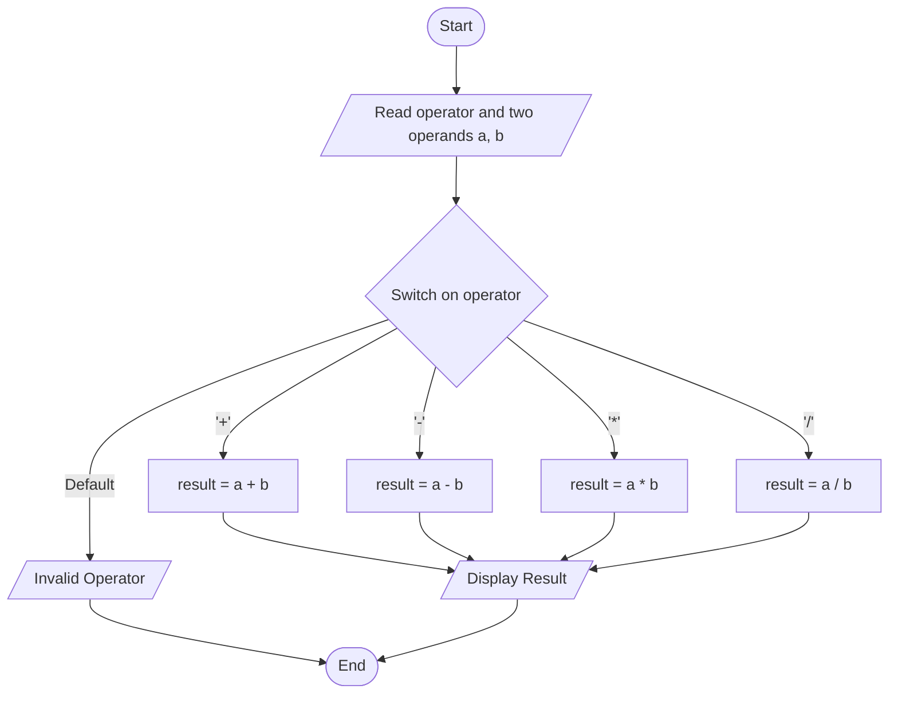
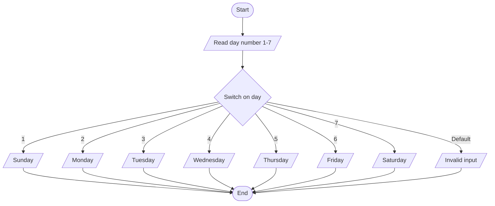

# Lab 13: switch Statement

## Question 38

Write a C program to perform basic arithmetic operations using switch.

**Flowchart**



**Program** ([`solution.c`](Q38_calculator_switch/solution.c))

```c
#include <stdio.h>
int main()
{
    double a, b;
    char op;

    printf("Enter an expression (number operator number): ");
    scanf("%lf %c %lf", &a, &op, &b);

    switch (op)
    {
        case '+':
            printf("%.2lf + %.2lf = %.2lf\n", a, b, a + b);
            break;
        case '-':
            printf("%.2lf - %.2lf = %.2lf\n", a, b, a - b);
            break;
        case '*':
            printf("%.2lf * %.2lf = %.2lf\n", a, b, a * b);
            break;
        case '/':
            if (b != 0)
                printf("%.2lf / %.2lf = %.2lf\n", a, b, a / b);
            else
                printf("Error: division by zero is not allowed.\n");
            break;
        default:
            printf("Invalid operator! Use +, -, * or /.\n");
    }

    return 0;
}
```

**Input**

```text
20 / 8
```

**Output**

```text
Enter an expression (number operator number): 20 / 8
20.00 / 8.00 = 2.50
```

---

## Question 39

Write a C program to display the day of the week using switch.

**Flowchart**



**Program** ([`solution.c`](Q39_day_switch/solution.c))

```c
#include <stdio.h>
int main()
{
    int day;

    printf("Enter a number (1 to 7): ");
    scanf("%d", &day);

    // 1 = Monday, 2 = Tuesday, ... 7 = Sunday
    switch (day)
    {
        case 1:
            printf("The day is Monday.\n");
            break;
        case 2:
            printf("The day is Tuesday.\n");
            break;
        case 3:
            printf("The day is Wednesday.\n");
            break;
        case 4:
            printf("The day is Thursday.\n");
            break;
        case 5:
            printf("The day is Friday.\n");
            break;
        case 6:
            printf("The day is Saturday.\n");
            break;
        case 7:
            printf("The day is Sunday.\n");
            break;
        default:
            printf("Invalid input! Please enter a number from 1 to 7.\n");
    }

    return 0;
}
```

**Input**

```text
6
```

**Output**

```text
Enter a number (1 to 7): 6
The day is Saturday.
```

---
