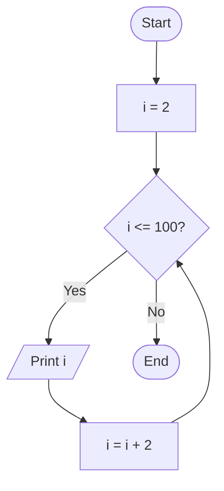

# Lab 14: Loops

## Question 41

Write a C program to print numbers from 1 to 100 using a for loop.

**Flowchart**


**Program** ([`solution.c`](Q41_print_1_to_100/solution.c))

```c
#include <stdio.h>
int main()
{
    int i;

    for (i = 1; i <= 100; i++)
    {
        printf("%d ", i);
    }
    printf("\n");

    return 0;
}
```

**Input**

No input required.

**Output**

```text
1 2 3 4 5 6 7 8 9 10 11 12 13 14 15 16 17 18 19 20 21 22 23 24 25 26 27 28 29 30 31 32 33 34 35 36 37 38 39 40 41 42 43 44 45 46 47 48 49 50 51 52 53 54 55 56 57 58 59 60 61 62 63 64 65 66 67 68 69 70 71 72 73 74 75 76 77 78 79 80 81 82 83 84 85 86 87 88 89 90 91 92 93 94 95 96 97 98 99 100 
```

---

## Question 42

Write a C program to print even numbers from 1 to 100.

**Flowchart**



**Program** ([`solution.c`](Q42_even_1_to_100/solution.c))

```c
#include <stdio.h>
int main()
{
    int i;

    for (i = 2; i <= 100; i += 2)
    {
        printf("%d ", i);
    }
    printf("\n");

    return 0;
}
```

**Input**

No input required.

**Output**

```text
2 4 6 8 10 12 14 16 18 20 22 24 26 28 30 32 34 36 38 40 42 44 46 48 50 52 54 56 58 60 62 64 66 68 70 72 74 76 78 80 82 84 86 88 90 92 94 96 98 100 
```

---
