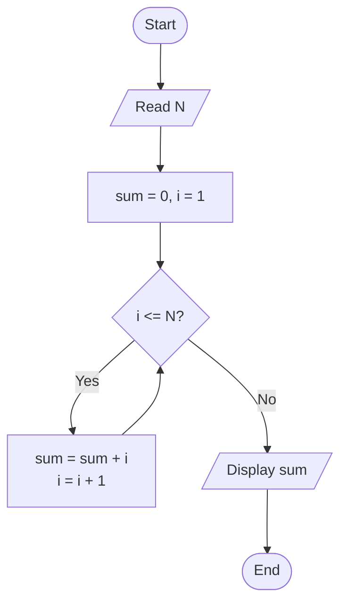
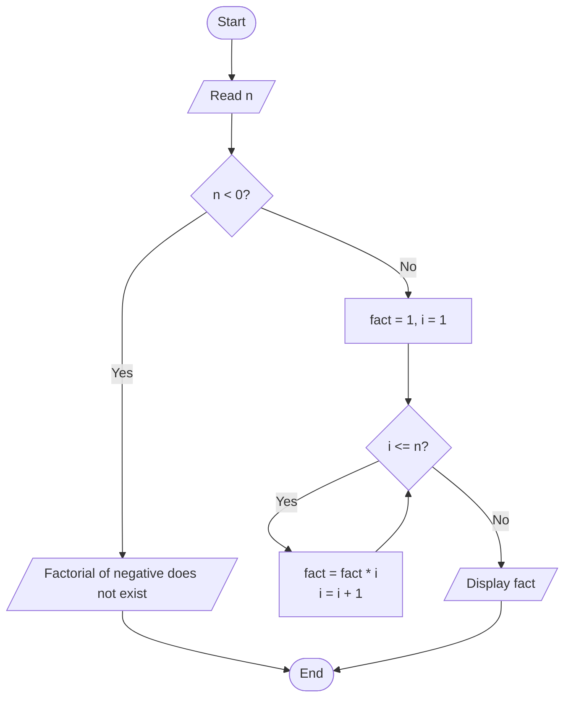

# Lab 15: for Loop Problems

## Question 44

Write a C program to calculate the sum of the first N natural numbers.

**Flowchart**


**Program** ([`solution.c`](Q44_sum_of_n/solution.c))

```c
#include <stdio.h>
int main()
{
    int n, i, sum = 0;

    printf("Enter the value of N: ");
    scanf("%d", &n);

    for (i = 1; i <= n; i++)
    {
        sum = sum + i;
    }

    printf("Sum of the first %d natural numbers = %d\n", n, sum);

    return 0;
}
```

**Input**

```text
10
```

**Output**

```text
Enter the value of N: 10
Sum of the first 10 natural numbers = 55
```

---

## Question 45

Write a C program to calculate the factorial of a number.

**Flowchart**



**Program** ([`solution.c`](Q45_factorial/solution.c))

```c
#include <stdio.h>
int main()
{
    int n, i;
    unsigned long long fact = 1;

    printf("Enter a number: ");
    scanf("%d", &n);

    if (n < 0)
        printf("Factorial is not defined for negative numbers.\n");
    else
    {
        for (i = 1; i <= n; i++)
        {
            fact = fact * i;
        }
        printf("Factorial of %d = %llu\n", n, fact);
    }

    return 0;
}
```

**Input**

```text
5
```

**Output**

```text
Enter a number: 5
Factorial of 5 = 120
```

> Note: unsigned long long can store factorials correctly up to 20! only; larger values overflow.

---
