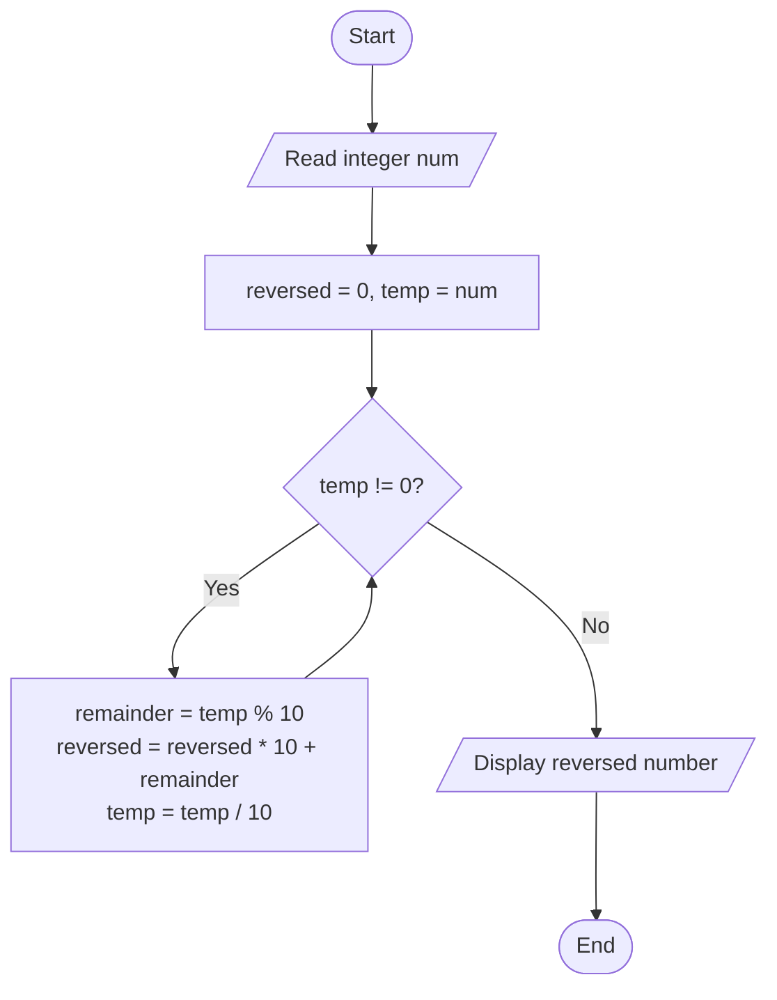
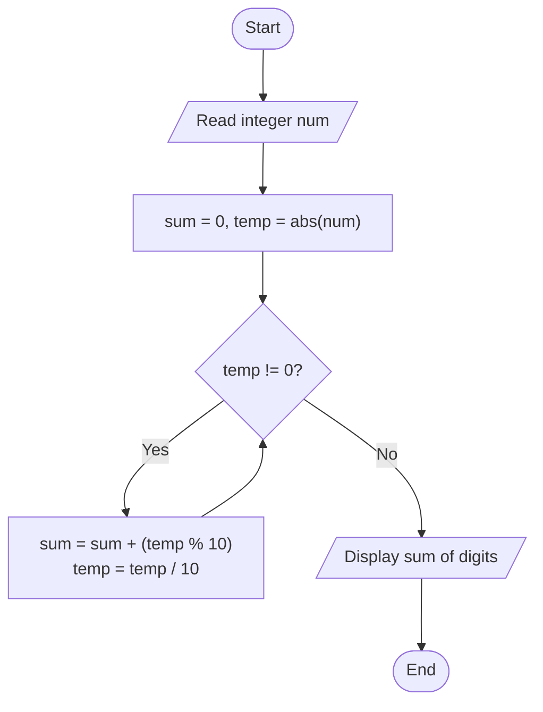

# Lab 16: while and do-while

## Question 47

Write a C program to reverse the digits of an integer using a while loop.

**Flowchart**



**Program** ([`solution.c`](Q47_reverse_digits/solution.c))

```c
#include <stdio.h>
int main()
{
    int num, n, rev = 0, digit;

    printf("Enter an integer: ");
    scanf("%d", &num);

    n = num;
    while (n != 0)
    {
        digit = n % 10;
        rev = rev * 10 + digit;
        n = n / 10;
    }

    printf("Reverse of %d = %d\n", num, rev);

    return 0;
}
```

**Input**

```text
12345
```

**Output**

```text
Enter an integer: 12345
Reverse of 12345 = 54321
```

---

## Question 48

Write a C program to find the sum of the digits of a number.

**Flowchart**



**Program** ([`solution.c`](Q48_sum_of_digits/solution.c))

```c
#include <stdio.h>
int main()
{
    int num, n, digit, sum = 0;

    printf("Enter a number: ");
    scanf("%d", &num);

    n = num;
    if (n < 0)
        n = -n;

    do
    {
        digit = n % 10;
        sum = sum + digit;
        n = n / 10;
    } while (n != 0);

    printf("Sum of the digits of %d = %d\n", num, sum);

    return 0;
}
```

**Input**

```text
4829
```

**Output**

```text
Enter a number: 4829
Sum of the digits of 4829 = 23
```

---
