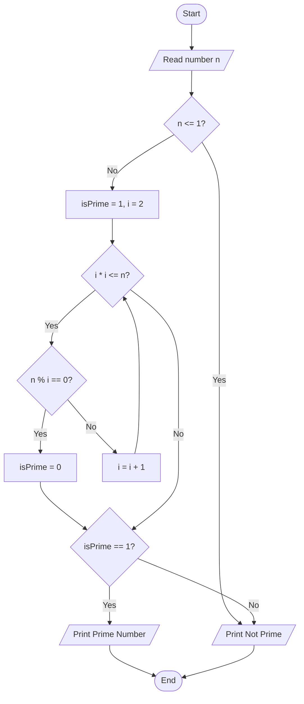
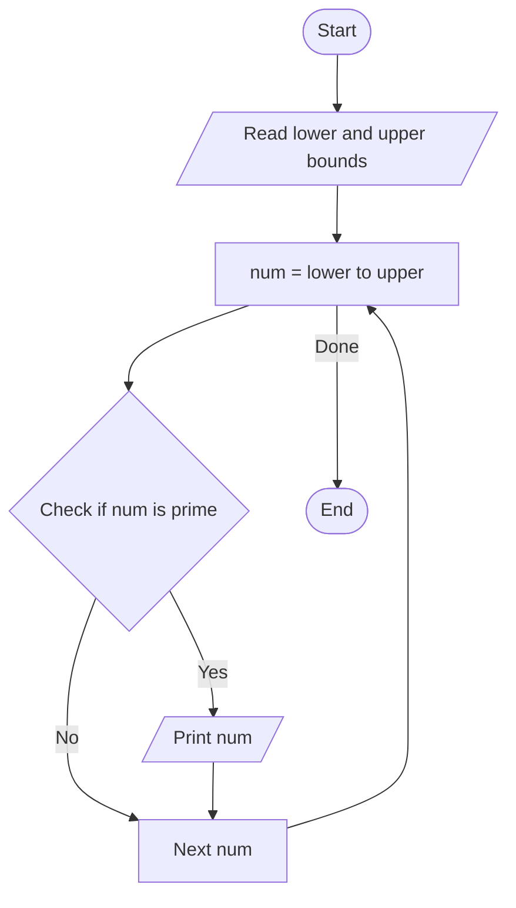

# Lab 17: Number Problems

## Question 50

Write a C program to check whether a number is a prime number.

**Flowchart**



**Program** ([`solution.c`](Q50_prime_check/solution.c))

```c
#include <stdio.h>
int main()
{
    int n, i, isPrime = 1;

    printf("Enter a number: ");
    scanf("%d", &n);

    if (n <= 1)
        isPrime = 0;

    for (i = 2; i <= n / 2; i++)
    {
        if (n % i == 0)
        {
            isPrime = 0;
            break;
        }
    }

    if (isPrime == 1)
        printf("%d is a prime number.\n", n);
    else
        printf("%d is not a prime number.\n", n);

    return 0;
}
```

**Input**

```text
29
```

**Output**

```text
Enter a number: 29
29 is a prime number.
```

---

## Question 51

Write a C program to print all prime numbers between two given numbers.

**Flowchart**



**Program** ([`solution.c`](Q51_primes_in_range/solution.c))

```c
#include <stdio.h>
int main()
{
    int low, high, n, i, temp, isPrime;

    printf("Enter two numbers: ");
    scanf("%d %d", &low, &high);

    if (low > high)
    {
        temp = low;
        low = high;
        high = temp;
    }

    printf("Prime numbers between %d and %d: ", low, high);

    for (n = low; n <= high; n++)
    {
        isPrime = 1;

        if (n < 2)
            isPrime = 0;

        for (i = 2; i <= n / 2; i++)
        {
            if (n % i == 0)
            {
                isPrime = 0;
                break;
            }
        }

        if (isPrime == 1)
            printf("%d ", n);
    }
    printf("\n");

    return 0;
}
```

**Input**

```text
10 50
```

**Output**

```text
Enter two numbers: 10 50
Prime numbers between 10 and 50: 11 13 17 19 23 29 31 37 41 43 47 
```

---
