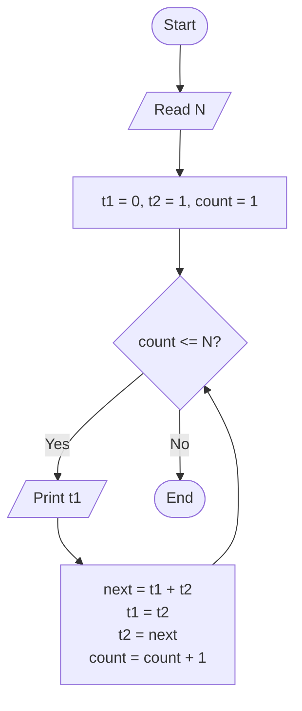
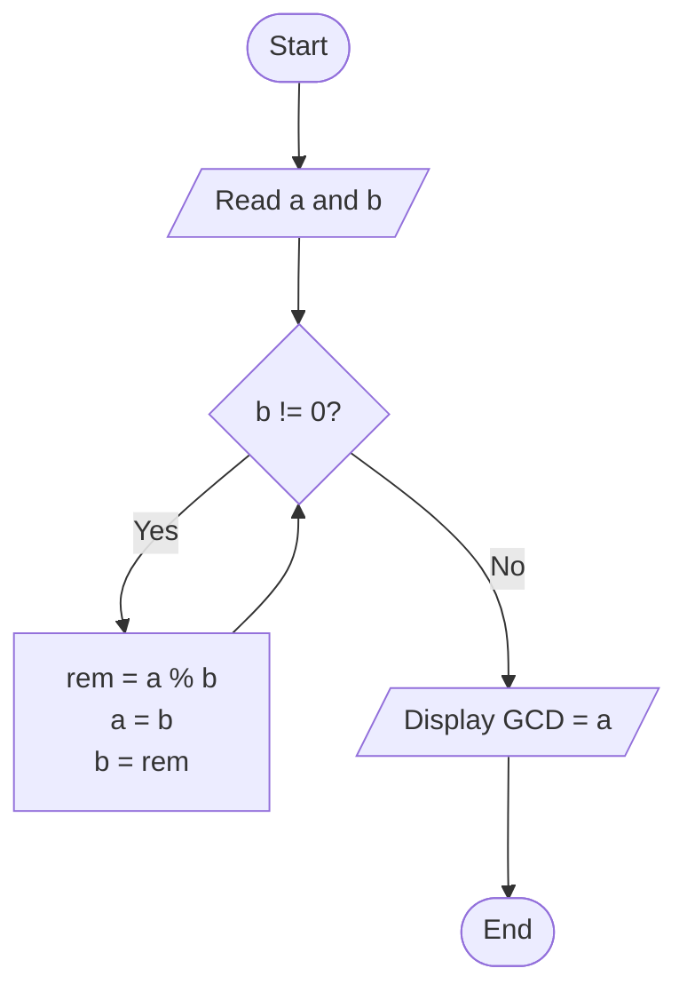

# Lab 18: Number Series

## Question 53

Write a C program to generate the Fibonacci series up to N terms.

**Flowchart**



**Program** ([`solution.c`](Q53_fibonacci/solution.c))

```c
#include <stdio.h>
int main()
{
    int n, i;
    long long first = 0, second = 1, next;

    printf("Enter the number of terms: ");
    scanf("%d", &n);

    printf("Fibonacci series: ");
    for (i = 1; i <= n; i++)
    {
        printf("%lld ", first);
        next = first + second;
        first = second;
        second = next;
    }
    printf("\n");

    return 0;
}
```

**Input**

```text
10
```

**Output**

```text
Enter the number of terms: 10
Fibonacci series: 0 1 1 2 3 5 8 13 21 34 
```

---

## Question 54

Write a C program to find the GCD of two numbers.

**Flowchart**



**Program** ([`solution.c`](Q54_gcd/solution.c))

```c
#include <stdio.h>
int main()
{
    int a, b, x, y, temp;

    printf("Enter two positive integers: ");
    scanf("%d %d", &a, &b);

    x = a;
    y = b;

    while (y != 0)
    {
        temp = y;
        y = x % y;
        x = temp;
    }

    printf("GCD of %d and %d = %d\n", a, b, x);

    return 0;
}
```

**Input**

```text
48 18
```

**Output**

```text
Enter two positive integers: 48 18
GCD of 48 and 18 = 6
```

---
