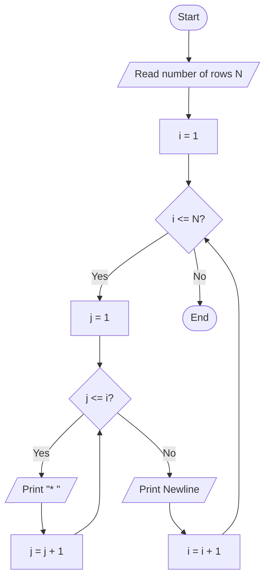
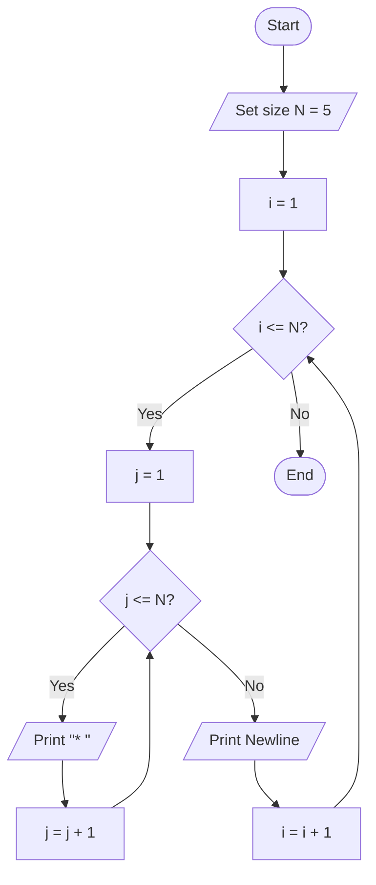

# Lab 19: Nested Loops

## Question 56

Write a C program to print a right-angled star pattern.

**Flowchart**



**Program** ([`solution.c`](Q56_right_triangle_pattern/solution.c))

```c
#include <stdio.h>
int main()
{
    int rows, i, j;

    printf("Enter the number of rows: ");
    scanf("%d", &rows);

    for (i = 1; i <= rows; i++)
    {
        for (j = 1; j <= i; j++)
        {
            printf("* ");
        }
        printf("\n");
    }

    return 0;
}
```

**Input**

```text
5
```

**Output**

```text
Enter the number of rows: 5
* 
* * 
* * * 
* * * * 
* * * * * 
```

---

## Question 57

Write a C program to print a square star pattern.

**Flowchart**



**Program** ([`solution.c`](Q57_square_pattern/solution.c))

```c
#include <stdio.h>
int main()
{
    int rows, i, j;

    printf("Enter the number of rows: ");
    scanf("%d", &rows);

    for (i = 1; i <= rows; i++)
    {
        for (j = 1; j <= rows; j++)
        {
            printf("* ");
        }
        printf("\n");
    }

    return 0;
}
```

**Input**

```text
5
```

**Output**

```text
Enter the number of rows: 5
* * * * * 
* * * * * 
* * * * * 
* * * * * 
* * * * * 
```

---
