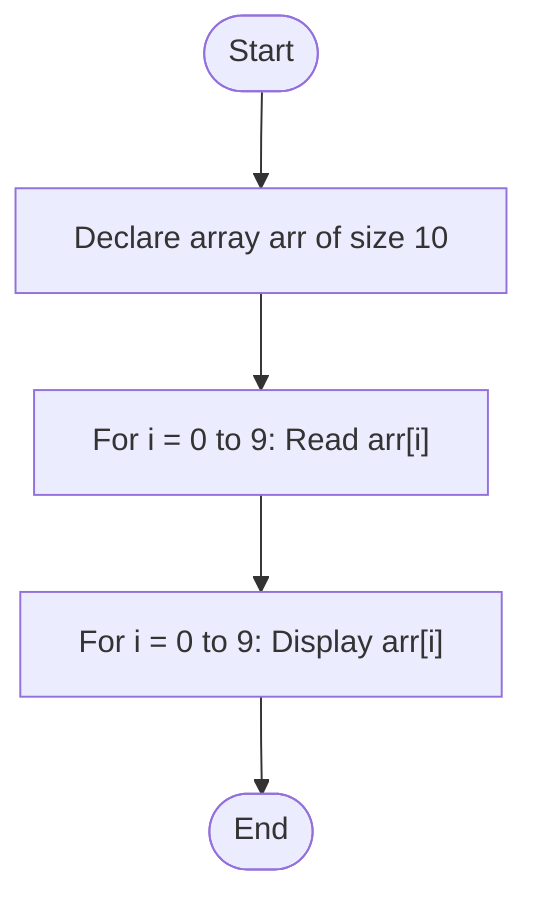
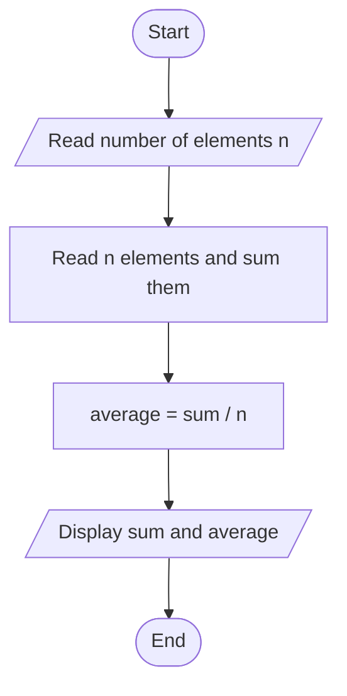

# Lab 20: Arrays

## Question 59

Write a C program to input and display the elements of a one-dimensional array from 1 to 10 numbers.

**Flowchart**



**Program** ([`solution.c`](Q59_array_input_display/solution.c))

```c
#include <stdio.h>
int main()
{
    int arr[10], n, i;

    printf("How many numbers do you want to enter (1 to 10)? ");
    scanf("%d", &n);

    if (n < 1 || n > 10)
    {
        printf("Invalid size! Please enter a number from 1 to 10.\n");
        return 0;
    }

    for (i = 0; i < n; i++)
    {
        printf("Enter element %d: ", i + 1);
        scanf("%d", &arr[i]);
    }

    printf("The elements of the array are: ");
    for (i = 0; i < n; i++)
    {
        printf("%d ", arr[i]);
    }
    printf("\n");

    return 0;
}
```

**Input**

```text
5
8
15
23
42
56
```

**Output**

```text
How many numbers do you want to enter (1 to 10)? 5
Enter element 1: 8
Enter element 2: 15
Enter element 3: 23
Enter element 4: 42
Enter element 5: 56
The elements of the array are: 8 15 23 42 56 
```

---

## Question 60

Write a C program to find the sum and average of array elements from user input.

**Flowchart**



**Program** ([`solution.c`](Q60_array_sum_average/solution.c))

```c
#include <stdio.h>
int main()
{
    int arr[100], n, i, sum = 0;
    float average;

    printf("Enter the number of elements (1 to 100): ");
    scanf("%d", &n);

    if (n < 1 || n > 100)
    {
        printf("Invalid size! Please enter a number from 1 to 100.\n");
        return 0;
    }

    for (i = 0; i < n; i++)
    {
        printf("Enter element %d: ", i + 1);
        scanf("%d", &arr[i]);
        sum = sum + arr[i];
    }

    average = (float)sum / n;

    printf("Sum     = %d\n", sum);
    printf("Average = %.2f\n", average);

    return 0;
}
```

**Input**

```text
6
12
7
25
3
18
9
```

**Output**

```text
Enter the number of elements (1 to 100): 6
Enter element 1: 12
Enter element 2: 7
Enter element 3: 25
Enter element 4: 3
Enter element 5: 18
Enter element 6: 9
Sum     = 74
Average = 12.33
```

---
